<p align="center">
  
</p>

<h1 align="center">MyMusic</h1>

<p align="center">
  <strong>Your music. Your library. Your desktop.</strong><br />
  A cross-platform music experience built with Python, PyQt5 and Qt Multimedia.
</p>

<p align="center">
  
  
  
  <a href="LICENSE"></a>
</p>

<p align="center">
  <strong>English</strong> · <a href="docs/README_zh.md">简体中文</a>
</p>

<p align="center"><sub>MyMusic edition by <a href="https://github.com/4beru"><strong>Abel Ortega</strong></a></sub></p>

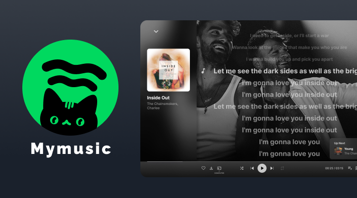

## About MyMusic

**MyMusic** brings together local music discovery, library organization, and playback in a desktop-first interface. Built with **Python and Qt 5**, it combines a customizable UI with audio metadata management, lyrics, playlists, and optional online music integration.

## Features

- **Explore your collection** — browse local tracks, artists, and albums with associated metadata and artwork.
- **Organize your listening** — create playlists, manage a playback queue, and access recently played songs.
- **Enjoy flexible playback** — repeat and shuffle controls, compact player, volume control, and a dedicated playing view.
- **Work with lyrics and tags** — lyrics display, desktop lyrics, and song metadata editing.
- **Discover music online** — integrated searches and music-video features when external providers are available.
- **Feel at home on desktop** — configurable light/dark themes, system tray support, and platform-specific window behavior.

> Online search, streaming, downloads, and video playback depend on third-party services and their policies. Actual media-format compatibility depends on your system's multimedia codecs.


## Built with Qt

<p align="center">
  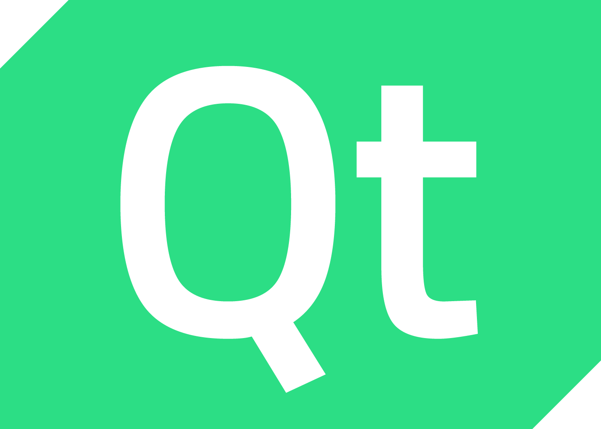
</p>

MyMusic's interface is built with **PyQt5**, while **Qt Multimedia** handles media playback. The project also uses Python for library indexing and metadata management, with **SQLite** for persistent local records. The included **Nix/devenv** configuration provides a reproducible Linux development environment.

## Screenshots

| Player | Artist library |
| :---: | :---: |
| 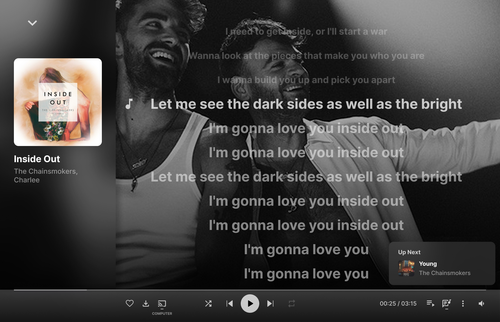 | 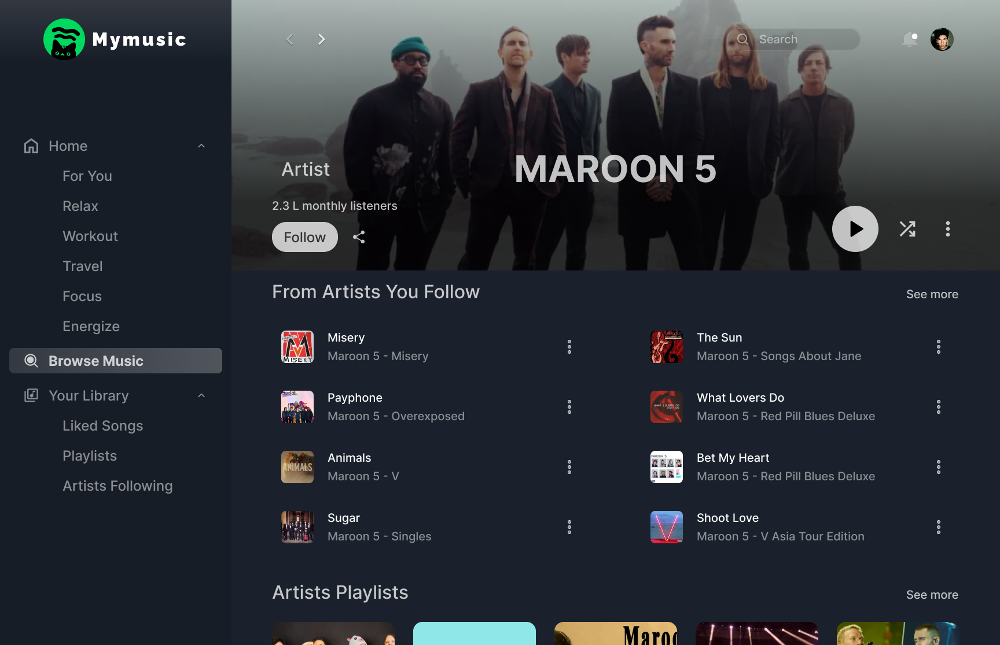 |
| Playback, artwork and lyrics | Explore your library by artist |


### Mobile-format previews

The repository also includes these portrait/mobile-format interface images. They are visual previews of the desktop project, not a claim that an Android or iOS application is available.

<p align="center">
  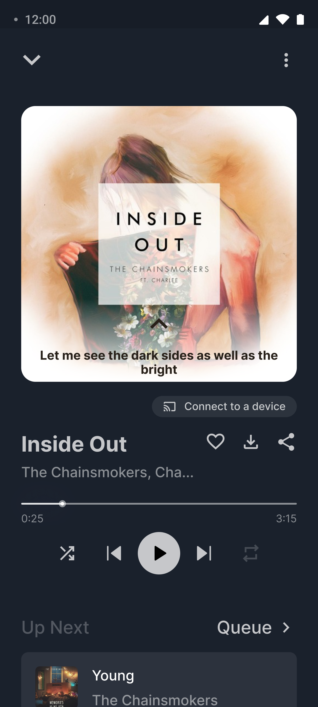
  &nbsp;&nbsp;
  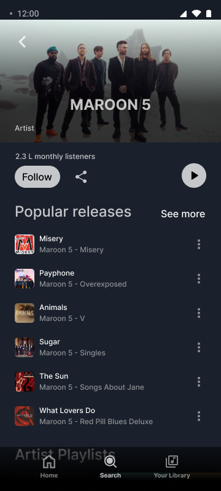
</p>

## Architecture

The desktop UI communicates with application services through Qt signals and slots, including a shared **SignalBus**. Music metadata and playlists use a local SQLite-backed data layer, while Qt Multimedia handles playback.

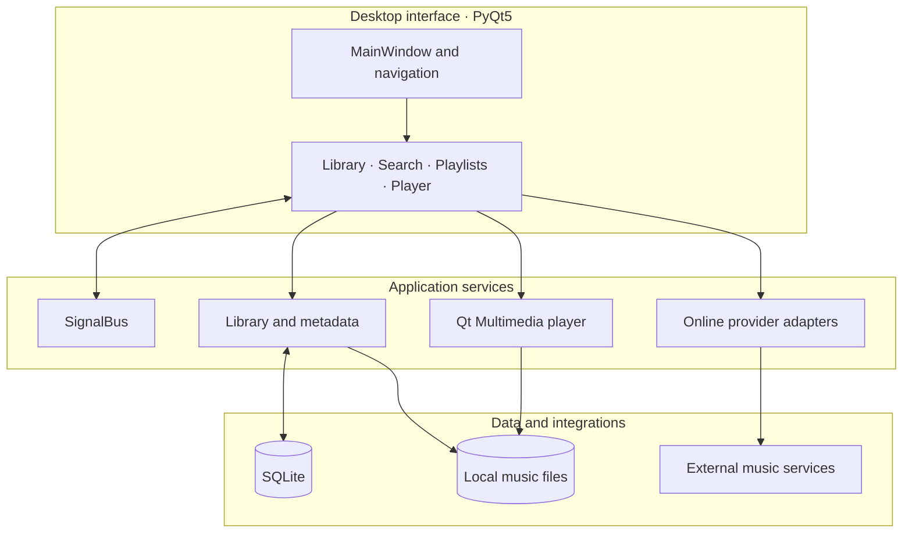

### How local music reaches the player

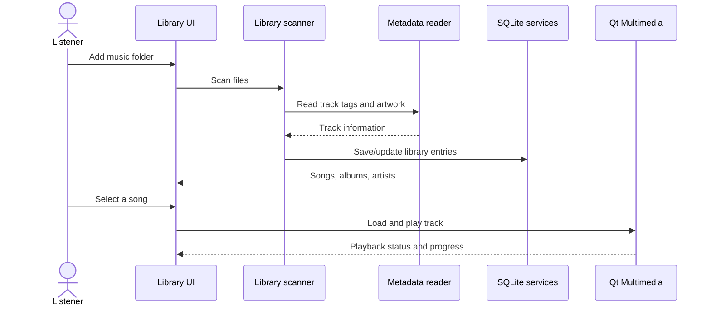


### Original architecture diagrams

The original project includes detailed diagrams of the interface hierarchy and its selection and album-card components. **They retain their original Chinese annotations** so the class names and relationships can be read in their original context. These are upstream design references; some details may differ from the current implementation.

**1. Interface structure — 界面结构**

<p align="center">
  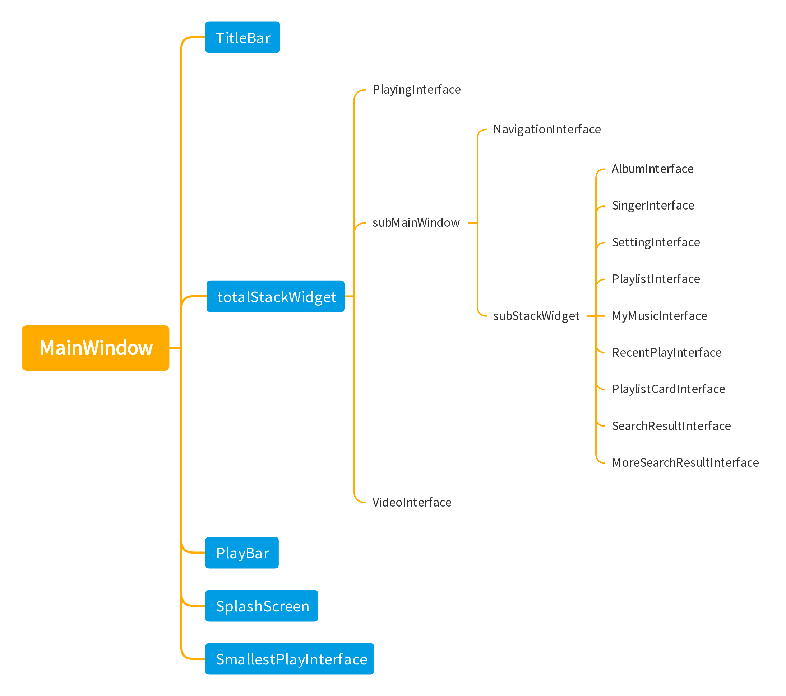
</p>

**2. Selection-mode interface — 选择模式界面类图**

<p align="center">
  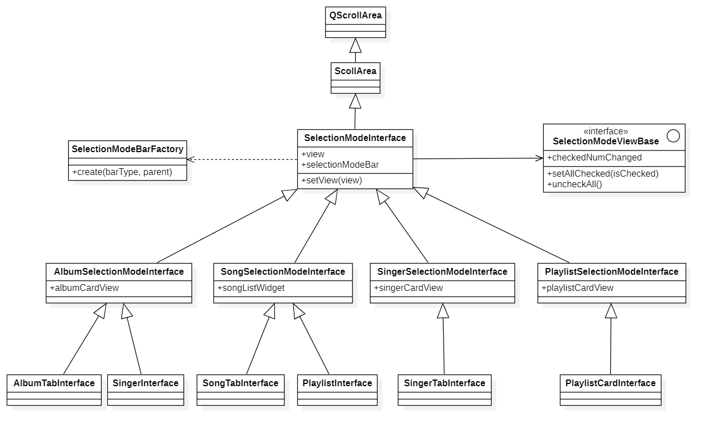
</p>

**3. Selection toolbar — 选择模式栏类图**

<p align="center">
  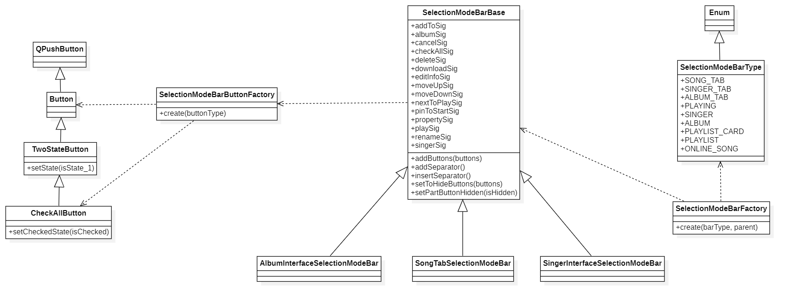
</p>

**4. Album-card view — 专辑卡视图类图**

<p align="center">
  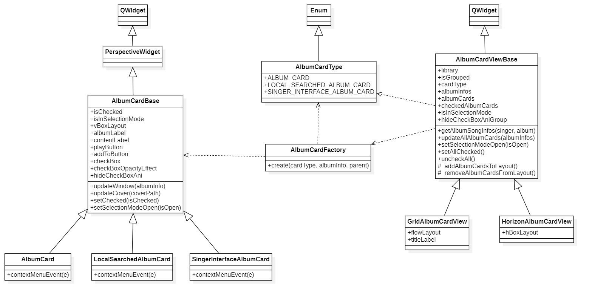
</p>

## Getting started

**Requirements:** Python **3.10–3.12**, [uv](https://docs.astral.sh/uv/) and an operational Qt Multimedia backend. The maintained dependency definitions are in [`pyproject.toml`](pyproject.toml).

### Python + uv

```bash
git clone https://github.com/4beru/mymusic-qt5.git
cd mymusic-qt5
uv sync
uv run python app/Groove.py
```

On **Linux**, install GStreamer and its relevant plugins using your distribution's package manager. On **Windows**, some media formats may require [LAV Filters](https://github.com/Nevcairiel/LAVFilters/releases). On **macOS**, use a compatible Qt multimedia backend.

### Reproducible Linux development with Nix

The included [`devenv.nix`](devenv.nix) provisions **Python 3.11**, uv synchronization, the Qt/X11 runtime and GStreamer plugins for Linux.

```bash
git clone https://github.com/4beru/mymusic-qt5.git
cd mymusic-qt5
devenv shell
run-app
```

The `run-app` script launches `app/Groove.py`. This Nix configuration targets Linux/X11 rather than every supported operating system.

## Codebase at a glance

```text
app/
├── Groove.py             # Application entry point
├── View/                 # Screens and navigation
├── components/           # Custom widgets and media player
├── common/
│   ├── crawler/          # Music-service integrations
│   ├── database/         # SQLite DAO, services and controllers
│   ├── library/          # Local library scanning
│   ├── meta_data/        # Tags and cover artwork
│   └── signal_bus.py     # Application-wide signals
└── resource/              # Qt assets and translations
docs/                      # User and developer documentation
devenv.nix                 # Reproducible Linux environment
pyproject.toml             # Python project configuration
```

The app offers **English, Simplified Chinese and Traditional Chinese** localization options. Documentation in this repository is presented in **English and Simplified Chinese**.

## Documentation

The user and developer guides are available in English and Simplified Chinese. This README links to the English edition. For Chinese documentation, see the [中文文档](docs/README_zh.md#相关文档).

| Guide | Topics |
| --- | --- |
| **User guide** | [Getting started](docs/source/en/user-guide/quick-start.md) · [Supported audio formats](docs/source/en/user-guide/supported-formats.md) · [Playback modes](docs/source/en/user-guide/playback-logic.md) · [Keyboard shortcuts](docs/source/en/user-guide/hotkey.md) · [Lyric file formats](docs/source/en/user-guide/lyrics-format.md) · [FAQ](docs/source/en/user-guide/faq.md) |
| **Developer guide** | [Development setup](docs/source/en/developer-guide/quick-start.md) · [Software architecture](docs/source/en/developer-guide/architecture.md) · [Development conventions](docs/source/en/developer-guide/development-standard.md) · [Database design](docs/source/en/developer-guide/database.md) · [Signal bus](docs/source/en/developer-guide/signal-bus.md) · [Qt development notes](docs/source/en/developer-guide/development-experience.md) · [About the project](docs/source/en/developer-guide/about.rst) |

The English guide retains the original architecture diagrams, with English explanations and current setup instructions. The original Chinese documentation remains available separately.

## Authorship and license

**MyMusic edition, branding and repository maintenance:** **[Abel Ortega](https://github.com/4beru)**.

Distributed under the **GNU General Public License v3.0**; see [LICENSE](LICENSE). Third-party songs, artwork, lyrics and videos remain the property of their respective rights holders.
