<p align="center">
  
</p>

<h1 align="center">MyMusic</h1>

<p align="center">
  <strong>你的音乐，你的曲库，你的桌面。</strong><br />
  基于 Python、PyQt5 和 Qt Multimedia 构建的跨平台音乐播放器。
</p>

<p align="center">
  
  
  
  <a href="../LICENSE"></a>
</p>

<p align="center">
  <a href="../README.md">English</a> · <strong>简体中文</strong>
</p>

<p align="center"><sub>MyMusic 版本作者与维护者：<a href="https://github.com/4beru"><strong>Abel Ortega</strong></a></sub></p>

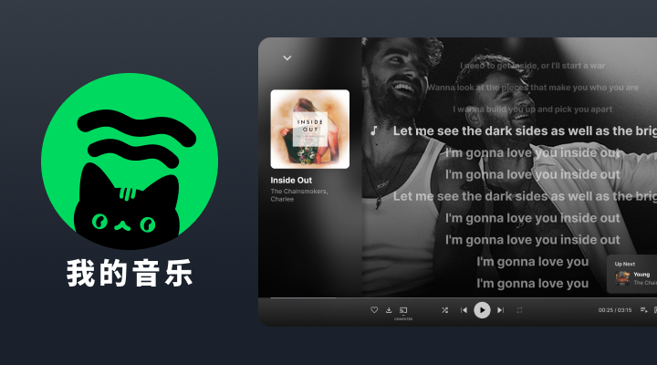

## 项目简介

**MyMusic** 将本地音乐管理、曲库浏览和播放功能整合到专为桌面设计的界面中。项目基于 **Python 和 Qt 5**，支持歌曲信息管理、歌词、播放列表及可选的在线音乐功能。

本仓库是 **Abel Ortega 基于 [Groove Music](https://github.com/zhiyiYo/Groove) 维护和开发的版本**。为了与上游代码保持兼容，部分模块及 `app/Groove.py` 启动入口仍使用原有名称。原作者信息与许可证见[文末](#作者与许可证)。

## 核心功能

- **浏览本地曲库** — 按歌曲、歌手和专辑管理音乐，读取音频标签和封面。
- **组织播放内容** — 创建播放列表、管理播放队列并查看最近播放记录。
- **灵活的播放控制** — 随机与循环播放、迷你播放器、音量控制及完整播放界面。
- **歌词与歌曲标签** — 歌词显示、桌面歌词和歌曲元数据编辑。
- **探索在线音乐** — 在第三方服务可用时搜索音乐及访问音乐视频。
- **原生桌面体验** — 深色/浅色主题、系统托盘和不同平台的窗口适配。

> 在线搜索、音频流、下载和视频功能依赖第三方服务及其当前政策。支持的音频格式还取决于系统中可用的多媒体解码器。


## 基于 Qt 构建

<p align="center">
  
</p>

MyMusic 使用 **PyQt5** 构建桌面界面，通过 **Qt Multimedia** 实现媒体播放，使用 Python 管理曲库及歌曲元数据，并通过 **SQLite** 保存本地记录。仓库中的 **Nix/devenv** 配置还提供可复现的 Linux 开发环境。

## 应用截图

| 播放器 | 歌手曲库 |
| :---: | :---: |
| 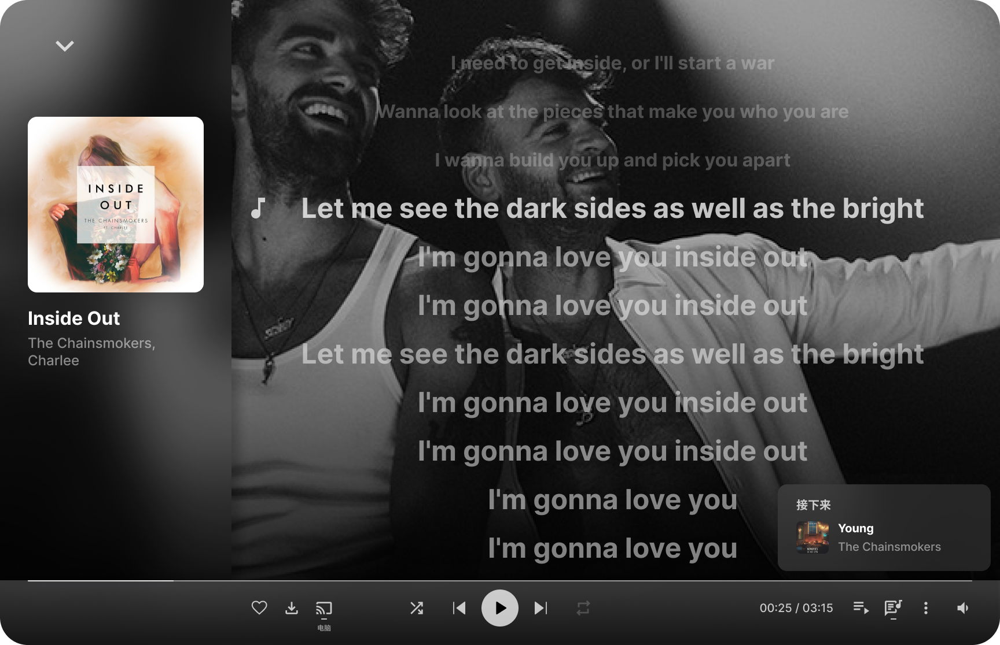 | 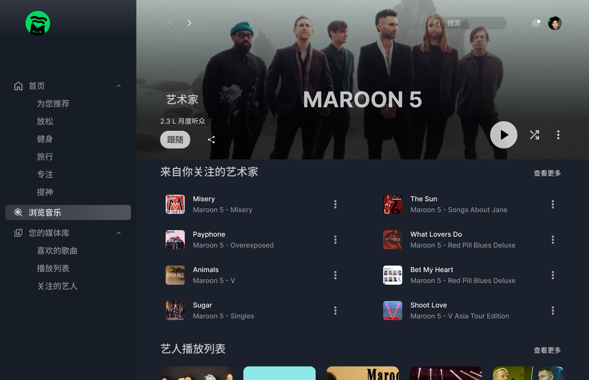 |
| 音乐播放、封面与歌词 | 按歌手浏览音乐 |


### 移动端尺寸的界面预览

仓库还提供以下竖版／移动端尺寸的界面图片。这些图片用于展示桌面项目的视觉设计，并不表示已经发布 Android 或 iOS 应用。

<p align="center">
  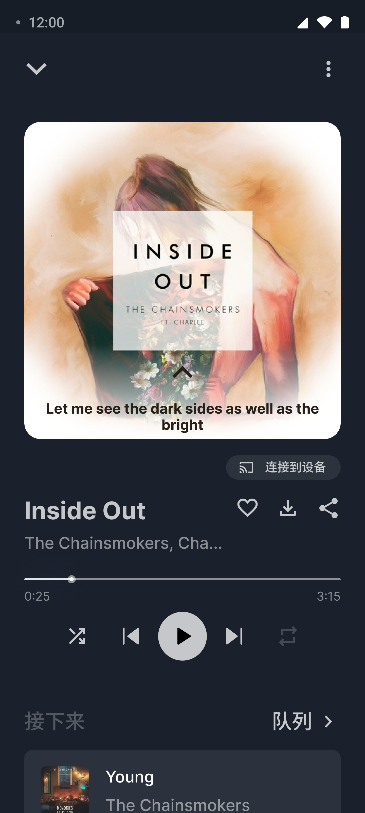
  &nbsp;&nbsp;
  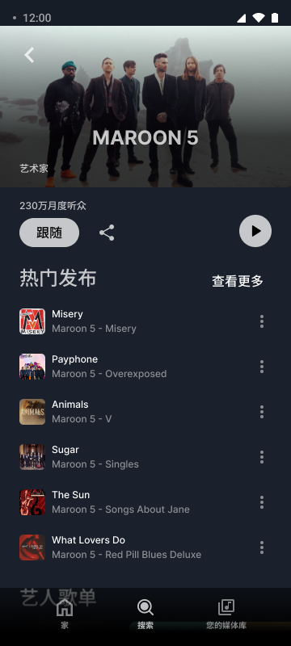
</p>

## 系统架构

桌面界面通过 Qt 信号与槽机制及全局 **SignalBus** 与应用服务通信。歌曲信息和播放列表使用基于 SQLite 的本地数据层，Qt Multimedia 负责音频播放。

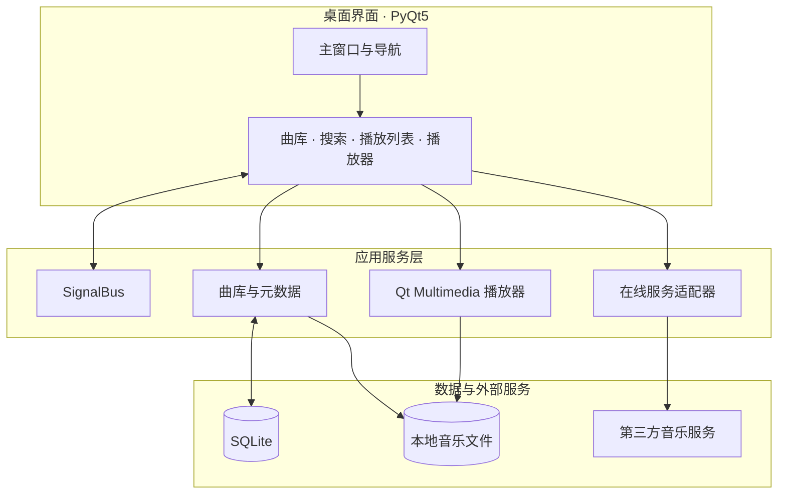

### 从本地曲库到音乐播放

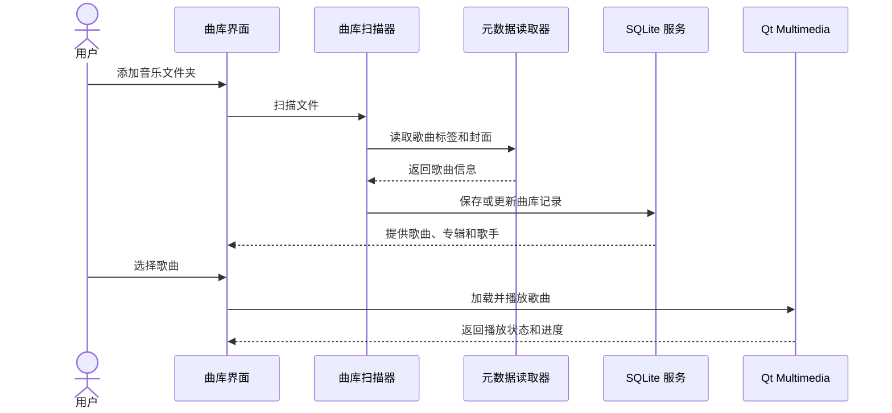


### 原始架构及类图

以下保留原始项目中的四张设计图，包括界面结构、选择模式及专辑卡视图。**图片中的中文名称和类图关系均保留原样**，便于对照原始设计。请注意，这些是上游设计参考，部分细节可能与当前代码实现有所不同。

**1. 界面结构**

<p align="center">
  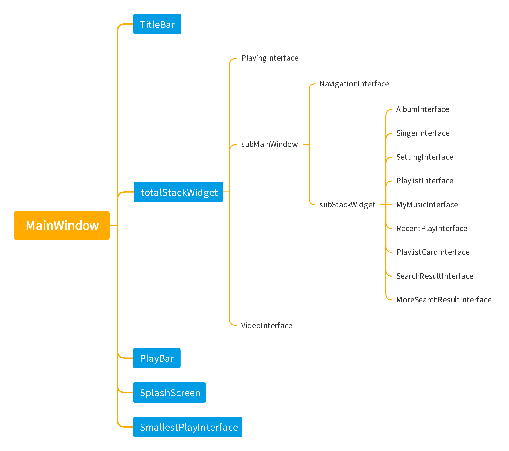
</p>

**2. 选择模式界面类图**

<p align="center">
  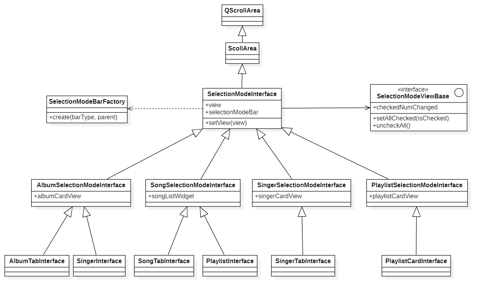
</p>

**3. 选择模式栏类图**

<p align="center">
  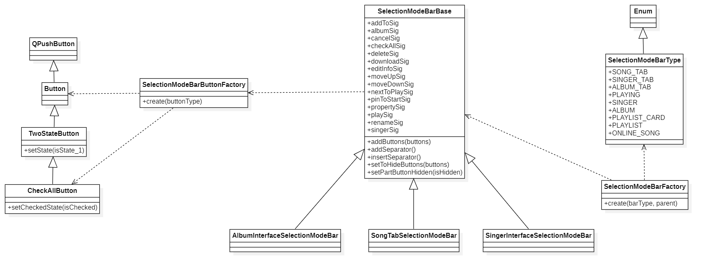
</p>

**4. 专辑卡视图类图**

<p align="center">
  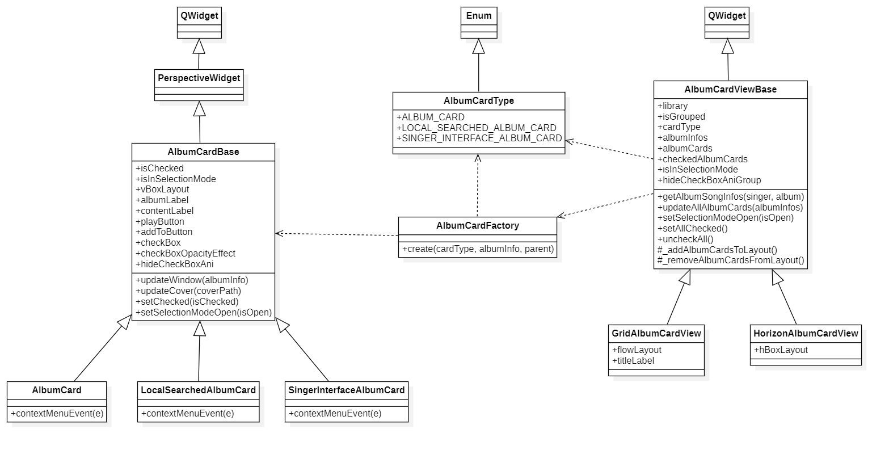
</p>

## 快速开始

**环境要求：** Python **3.10–3.12**、[uv](https://docs.astral.sh/uv/) 和可用的 Qt Multimedia 后端。项目依赖以 [`pyproject.toml`](../pyproject.toml) 为准。

### Python + uv

```bash
git clone https://github.com/4beru/mymusic-qt5.git
cd mymusic-qt5
uv sync
uv run python app/Groove.py
```

**Linux** 用户需要通过发行版包管理器安装 GStreamer 和相应插件。**Windows** 上部分格式可能需要 [LAV Filters](https://github.com/Nevcairiel/LAVFilters/releases)。**macOS** 需要配置兼容的 Qt 多媒体后端。

### 使用 Nix 构建可复现的 Linux 开发环境

仓库包含面向 Linux 的 [`devenv.nix`](../devenv.nix)，用于配置 **Python 3.11**、uv 依赖同步、Qt/X11 库和 GStreamer 插件。

```bash
git clone https://github.com/4beru/mymusic-qt5.git
cd mymusic-qt5
devenv shell
run-app
```

`run-app` 会启动 `app/Groove.py`。当前 Nix 配置主要面向 Linux/X11，并非为所有平台提供完全相同的环境。

## 项目结构

```text
app/
├── Groove.py             # 应用入口
├── View/                 # 页面与导航
├── components/           # Qt 自定义组件与播放器
├── common/
│   ├── crawler/          # 在线音乐服务适配器
│   ├── database/         # SQLite DAO、服务与控制器
│   ├── library/          # 本地音乐曲库
│   ├── meta_data/        # 歌曲标签与封面
│   └── signal_bus.py     # 全局事件通信
└── resource/              # Qt 资源与翻译文件
docs/                      # 用户及开发者文档
devenv.nix                 # 可复现的 Linux 环境
pyproject.toml             # Python 项目与依赖配置
```

应用支持 **英语、简体中文和繁体中文** 本地化选项；本仓库 README 及用户、开发者指南提供 **英语和简体中文** 两种版本。

## 相关文档

用户指南和开发者指南均提供英语和简体中文版本。本 README 链接至原始中文文档；如需阅读英语版本，请参阅 [English documentation](../README.md#documentation)。

| 指南 | 文档 |
| --- | --- |
| **用户指南** | [快速上手](source/user-guide/quick-start.md) · [音频格式](source/user-guide/supported-formats.md) · [播放逻辑](source/user-guide/playback-logic.md) · [快捷键](source/user-guide/hotkey.md) · [歌词文件](source/user-guide/lyrics-format.md) · [常见问题](source/user-guide/faq.md) |
| **开发者指南** | [开发环境](source/developer-guide/quick-start.md) · [软件架构](source/developer-guide/architecture.md) · [开发规范](source/developer-guide/development-standard.md) · [数据库](source/developer-guide/database.md) · [事件总线](source/developer-guide/signal-bus.md) · [开发经验](source/developer-guide/development-experience.md) · [关于项目](source/developer-guide/about.rst) |

英语版保留原始架构图，并根据当前仓库更新安装和开发环境说明；中文原始文档保持不变。

## 作者与许可证

**MyMusic 版本、品牌及仓库维护：** **[Abel Ortega](https://github.com/4beru)**。

**原始应用与代码基础：** [Groove Music](https://github.com/zhiyiYo/Groove)，作者 **zhiyiYo**（原始版权 © 2020 zhiyiYo）。本版本保留上游项目的署名。

本项目采用 **GNU General Public License v3.0**，详见 [LICENSE](../LICENSE)。第三方歌曲、封面、歌词和视频的版权归各自权利人所有。