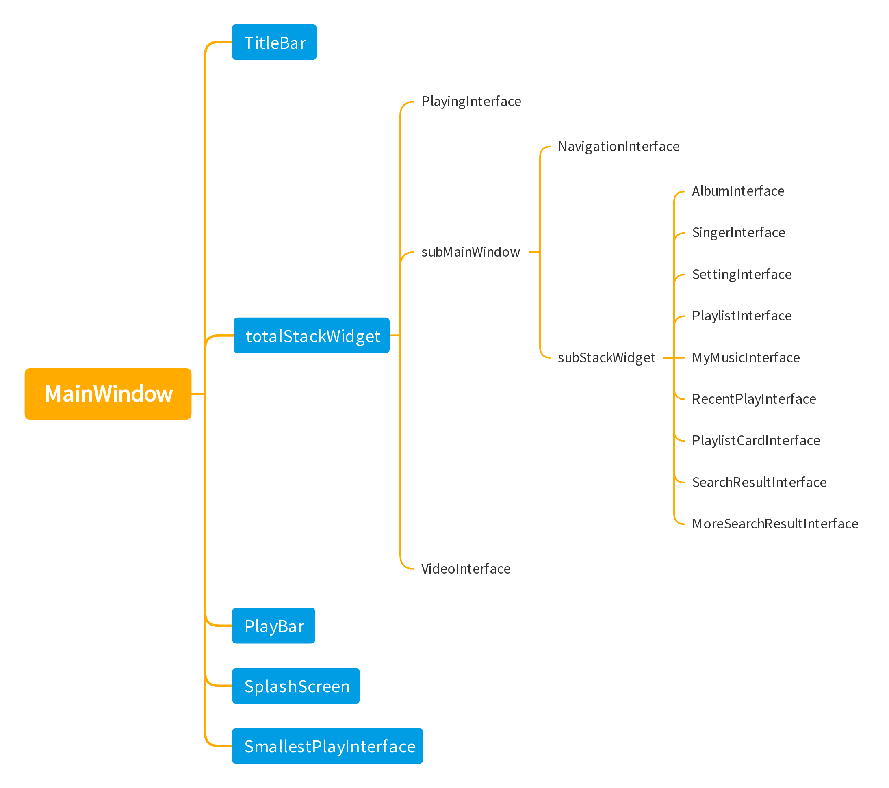
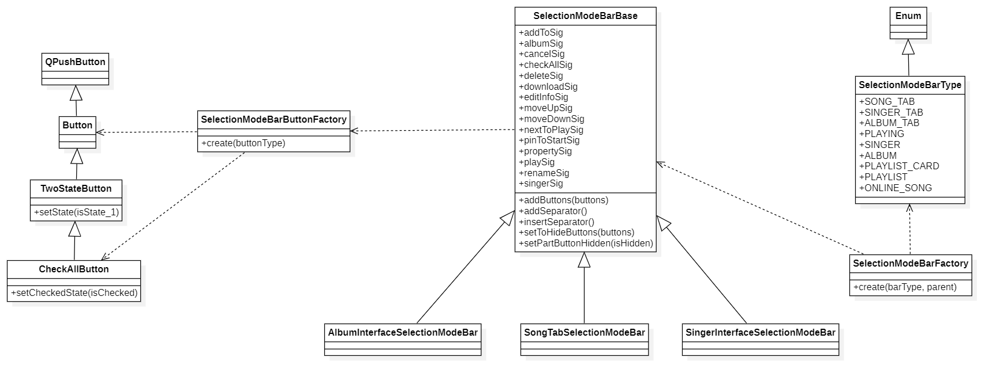
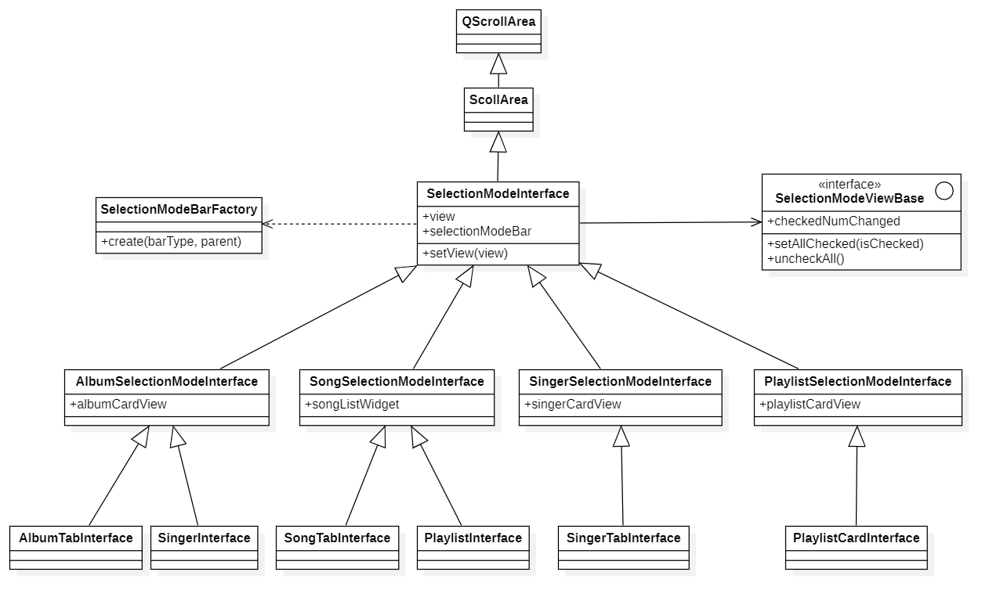
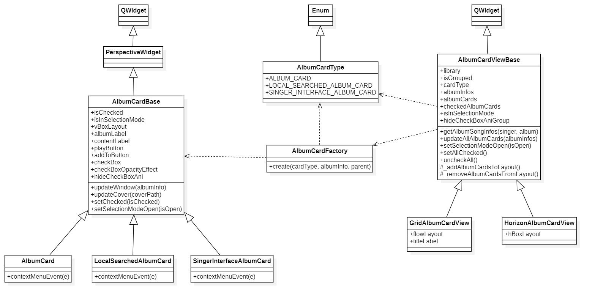

# Software architecture

MyMusic combines a PyQt5 widget hierarchy with Qt Multimedia, a local SQLite data layer, a library scanner and service adapters. UI components communicate through Qt signals and slots, including a shared signal bus.

## Core modules

| Responsibility | Python module or class |
| --- | --- |
| Online service adapters | `common.crawler` |
| Configuration | `common.config.Config` |
| Music library | `common.library.Library` |
| Main window | `View.main_window.MainWindow` |
| Player | `components.media_player.MediaPlayer` |
| Playback queue | `components.media_player.MediaPlaylist` |
| Application events | `common.signal_bus.SignalBus` |
| Media metadata | `common.meta_data` |

## UI structure

The original interface diagram illustrates how the main window coordinates its child views.

### Selection mode

A selection-enabled screen combines a content view and a `SelectionModeBar`. A factory creates the appropriate toolbar variant so the interface can be extended without embedding every toolbar type in the parent view.

Subclasses of `SelectionModeInterface` replace their content through `setView(view)`. Album cards, song lists, artist cards and playlist cards use the common `SelectionModeViewBase` contract.

### Album-card views

`AlbumCardViewBase` delegates card creation to `AlbumCardFactory`. Grid and horizontal layouts are represented by `GridAlbumCardView` and `HorizonAlbumCardView`.

The four original diagrams retain their Chinese labels and represent historical design references; check the current source before relying on a particular class relationship.

Further reading: [Database design](database.md) and [Signal bus](signal-bus.md).
