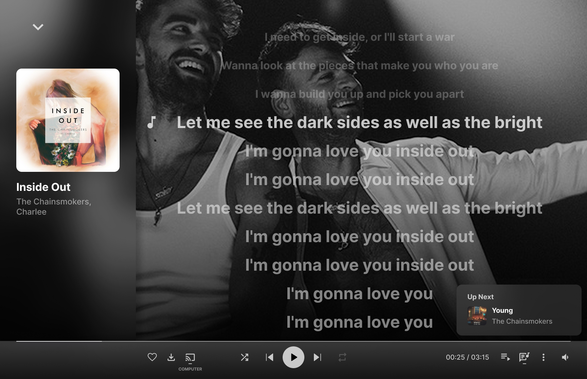
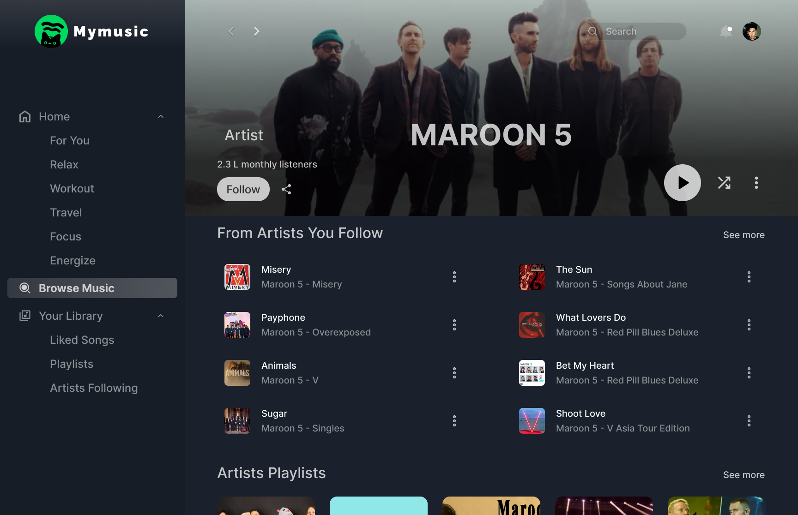

# Getting started

MyMusic is a desktop music player written in Python with PyQt5. Install a working Qt Multimedia backend before playing audio or video.

## Installation

From the repository root, with Python 3.10–3.12 and [uv](https://docs.astral.sh/uv/) available:

```bash
git clone https://github.com/4beru/mymusic-qt5.git
cd mymusic-qt5
uv sync
uv run python app/Groove.py
```

- **Windows:** install [LAV Filters](https://github.com/Nevcairiel/LAVFilters/releases) if required by the media backend.
- **Linux:** install GStreamer and the relevant decoder plugins using the distribution's package manager.
- **macOS:** use a compatible Qt Multimedia backend.

For Linux/X11, the repository also provides a reproducible Nix environment:

```bash
devenv shell
run-app
```

See the [developer setup](../developer-guide/quick-start.md) for details. Historical upstream installers are not a requirement for this edition.

## Using the application

- **Local library:** add folders containing music, browse songs, albums and artists, then select a track to start playback.
- **Online music:** search available providers and play or download supported tracks where permitted.
- **Playlists:** create a personal playlist and add or remove songs from it.
- **Metadata:** open a track's information to inspect or edit tags such as title, artist and album.
- **Music videos:** search and play available videos; downloading depends on provider availability and permissions.





See [supported formats](supported-formats.md), [playback modes](playback-logic.md) and [keyboard shortcuts](hotkey.md) for more information. Online features depend on third-party services.
